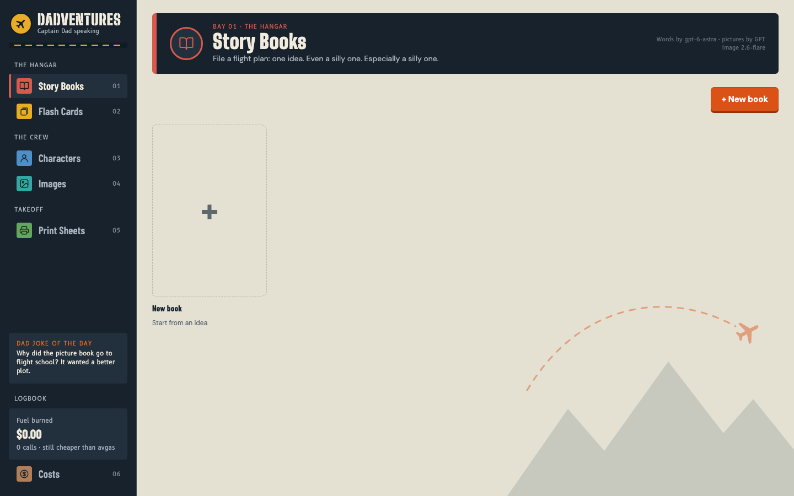

# Dadventures ✈️

**Captain Dad speaking.** This is a little studio that runs on your own computer and turns "tell me a story about an
octopus" into a real, printed, slightly sticky picture book.

You bring one idea (even a silly one, especially a silly one). It writes the story with you, paints the pictures,
keeps the characters looking like themselves from page to page, and lays everything out for the print shop.



## What you can make

- 📖 **Story books**: outline, page text and illustrations for a short children's book, one step at a time.
- 🃏 **Flash cards**: sets that teach something, or comic-style story series where each card ends on a hook.
- 🐙 **A recurring cast**: characters with reference pictures, so the octopus on page 9 is the octopus from page 1.
- 🖼️ **One-off pictures and posters** at 2K or 4K. Fridge-worthy, every time.
- 🖨️ **Print-ready PDFs**: several pictures per sheet, cut marks, double-sided if you like.
- ⛽ **A fuel gauge**: every model call is logged with its cost, so you always know what the fun is costing.

Everything stays on your machine. The only things that leave are the requests to the AI models you choose to use.

## Preflight checklist

| You need | Notes |
|---|---|
| **Node.js 22 or newer** | Check with `node -v`. Get it from [nodejs.org](https://nodejs.org). There is nothing to `npm install`. |
| **An OpenAI API key** | Create one at [platform.openai.com/api-keys](https://platform.openai.com/api-keys). Your account needs billing set up and access to the image models. |
| **A few dollars of fuel** | Every picture and every writing step is billed to your OpenAI account. A picture runs from a few cents to about a quarter depending on size and quality; the Costs page shows the running total. |
| **A Mac, ideally** | macOS is the tested platform. On Linux, Windows or Docker it still runs, with full-size images where a Mac would show thumbnails, and without "Reveal in Finder". |

## Takeoff in three steps

**1. Get the code**

```bash
git clone https://github.com/anand-codings/dadventures.git
cd dadventures
```

**2. Add your key**

```bash
cp .env.example .env
```

Open `.env` in any text editor and replace `sk-...` with your key:

```
OPENAI_API_KEY=sk-your-real-key
```

**3. Start the engines**

```bash
npm start
```

Open **http://127.0.0.1:53405** and you are in the hangar. Stop it any time with `Ctrl+C`; your work is saved in the
`output/` folder as you go.

<details>
<summary><b>Prefer Docker?</b></summary>

Do steps 1 and 2, then:

```bash
docker compose up --build
```

Same address: http://127.0.0.1:53405. Your pictures land in `./output` and the app reads your own images from
`./media`. Local upscaling is not available inside the container; cloud upscaling is.

</details>

## Your first flight: a book in a few minutes

1. Open **Story Books** and press **+ New book**.
2. Type one idea ("a shy crab who wants to join the band") and pick an age range. Stuck? **✨ Suggest ideas** pitches
   four.
3. Press the big button. It always runs the next step: **Outline → Page text → Picture prompts → Pictures → Read**.
   Check each step before moving on and edit anything you like; nothing costs much until the pictures.
4. Want the hero to look the same on every page? Use **🎨 Design character** on a cast member before illustrating.
5. Press **📖 Read** to page through it like a book, or download the pictures and lay them out in **Print Sheets**.

Tip: start with low quality and small sizes while you are finding the story, then redraw the keepers properly.

## Tour of the airfield

| Where | What happens there | Guide |
|---|---|---|
| **Story Books** | Outline, write and illustrate short books | [Story Books](docs/story-books.md) |
| **Flash Cards** | Turn cards you like into templates, then make sets and story series | [Flash Cards](docs/flash-cards.md) |
| **Characters** | Your cast, their reference pictures and every picture they appear in | [Character consistency](docs/characters.md) |
| **Images** | One-off pictures, prompt help, and the full history of everything you made | [Generating and history](docs/generating-and-history.md) |
| **Print Sheets** | Tile pictures onto a page and build a print-ready PDF | [Print Sheets](docs/print-sheets.md) |
| **Costs** | Spend per day, per model and per project | [AI calls and costs](docs/costs.md) |

Also handy: [upscaling for print](docs/upscaling.md) and [a link for every view](docs/links.md).

**Got pictures already?** Drop them into the [`media/`](media/README.md) folder. Print Sheets and the Flash Cards
library pick them up from there.

## Optional upgrades

- **Free, local upscaling.** Download the [Real-ESRGAN ncnn-vulkan](https://github.com/xinntao/Real-ESRGAN/releases)
  build for your system, then point `REALESRGAN_BIN` in `.env` at the binary. A 2K picture becomes print-sharp 8K in
  seconds. Details in the [upscaling guide](docs/upscaling.md).
- **Cloud upscaling.** Add a [fal.ai](https://fal.ai/dashboard/keys) key as `FAL_KEY` to unlock SeedVR2 and Topaz.
- **Different models.** Swap the writer or image model in `.env`; see the settings below.

## Turbulence (troubleshooting)

| What you see | What to do |
|---|---|
| `WARNING: OPENAI_API_KEY is not set` in the terminal, or "OPENAI_API_KEY is not set." in the app | The `.env` file is missing or still has `sk-...`. Fix it, then stop and start the app again. |
| `EADDRINUSE` when starting | Something else is using the port. Start on another one: `PORT=53500 npm start`. |
| "Host not allowed" in the browser | You opened the app by a hostname. Use `127.0.0.1`, `localhost` or an IP address, or add the name to `ALLOWED_HOSTS` in `.env`. |
| A picture fails with an access or permission error | Check on OpenAI's side that billing is active and your account can use the image models. |
| No upscale options | Neither `REALESRGAN_BIN` nor `FAL_KEY` is set. See "Optional upgrades". |
| `npm start` complains about syntax | Your Node is too old. `node -v` should say 22 or higher. |
| Thumbnails are slow or huge | You are not on a Mac. The app works, it just shows full-size images. |

Still stuck? [Open an issue](https://github.com/anand-codings/dadventures/issues) with what you did, what you
expected and what happened.

## Settings (`.env`)

Only `OPENAI_API_KEY` is required. Everything else has a sensible default.

<details>
<summary><b>All settings</b></summary>

| Variable | Default | Notes |
|---|---|---|
| `OPENAI_API_KEY` | — | required |
| `PORT` | `53405` | |
| `HOST` | `127.0.0.1` | set `0.0.0.0` to expose on LAN (see [Security](#security)) |
| `ALLOWED_HOSTS` | — | extra hostnames allowed to reach the app, comma separated (e.g. `studio.local`); `localhost` and IP addresses always work |
| `OUTPUT_DIR` | `output` | relative to the app dir, or absolute |
| `IMAGE_MODEL` | `gpt-image-2.6-flare` | default model in the UI |
| `ENHANCE_MODEL` | `gpt-5.4-mini` | text model used by Enhance |
| `BOOK_MODEL` | `gpt-6-astra` | text model that writes Story Book ideas, outlines and page scripts |
| `CARD_MODEL` | `BOOK_MODEL` | text model that writes Flash Card templates, series plans and card text |
| `CARD_VISION_MODEL` | `ENHANCE_MODEL` | vision model that reads existing cards in the Flash Cards library |
| `REALESRGAN_BIN` | — | path to the `realesrgan-ncnn-vulkan` binary; local upscaling is off when unset or missing (e.g. inside Docker) |
| `REALESRGAN_MODELS` | `<bin dir>/models` | folder with the `.param`/`.bin` model files |
| `FAL_KEY` | — | fal.ai API key; enables the cloud upscalers (SeedVR2, Topaz). Leave empty to hide them |
| `PRINT_ROOT` | `media` | folder of your own images that the Print Sheets picker and the Flash Cards library browse (five levels deep); relative to the app folder, or absolute |

</details>

## For the mechanics

| Path | What |
|---|---|
| [`src/`](src/README.md) | the Node server: HTTP routes, the AI gateway, books, cards and print sheets |
| [`public/`](public/README.md) | the browser UI: plain HTML, CSS and JavaScript, no build step |
| [`docs/`](docs/README.md) | feature guides |
| [`media/`](media/README.md) | your own images for Print Sheets and Flash Cards (contents ignored by git) |
| `output/` | created on first run: your images, prompts, logs and call records (ignored by git) |
| `.env.example` | copy to `.env` and add your key |
| `Dockerfile`, `docker-compose.yml` | optional container setup |

No framework, no build step, no dependencies: edit a file and reload. [CONTRIBUTING.md](CONTRIBUTING.md) has the
ground rules, and pull requests are welcome.

## Security

This is a single-user tool for your own machine. It has no login: anyone who can reach the port can spend your API
credit and read, change or delete everything under `output/`.

- It listens on `127.0.0.1` by default, and the Docker setup publishes the port to `127.0.0.1` only. Set
  `HOST=0.0.0.0` only on a network you trust, and never put it on the public internet without your own authentication
  in front.
- Requests are accepted only from the app's own pages. The server refuses requests whose `Origin` is another site and
  requests addressed to a hostname other than `localhost`, an IP address or an entry in `ALLOWED_HOSTS`, so a website
  open in another tab cannot drive it.
- Your API keys stay in `.env`, which is ignored by git, and are sent only to OpenAI and (when `FAL_KEY` is set) fal.ai.
- `output/` holds your images, every prompt, and the full request and reply of each model call, and `media/` holds
  your own images. Both are ignored by git; keep them out of anything you share.

Found a vulnerability? See [SECURITY.md](SECURITY.md).

## Disclaimer

An independent side project, not affiliated with or endorsed by OpenAI, fal.ai or Topaz Labs. You are responsible for
the content you generate and for following each provider's usage policies. Dad jokes are provided as is, with no
warranty of any kind.

## License

[MIT](LICENSE) © 2026 Anand B

The bundled fonts in `public/fonts/` are separate works under the SIL Open Font License 1.1; see
[`public/fonts/OFL.txt`](public/fonts/OFL.txt).
